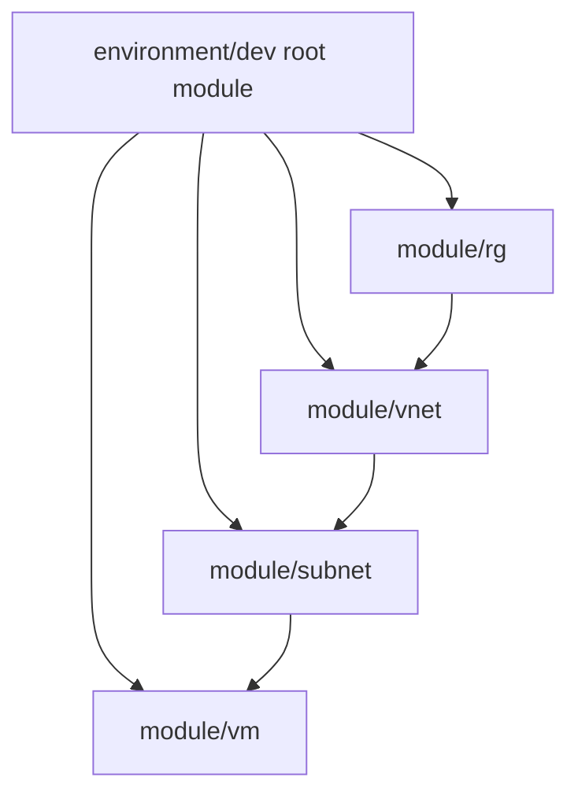

<div align="center">

# Azure Terraform Module Practice

**A learning lab for parent/child modules and Azure resource dependencies**

[](https://developer.hashicorp.com/terraform)
[](https://azure.microsoft.com/)

</div>

This repository contains a hands-on Terraform exercise for composing Azure resource-group, virtual-network, subnet, and VM modules from a development root module. It is a learning example, not a production landing zone.

## Architecture



## Repository layout

```text
child_parent module using data block180626/
  environment/dev/  Root configuration and development inputs
  module/rg/        Resource-group module
  module/vnet/      Virtual-network and NSG resources
  module/subnet/    Subnet module
  module/vm/        NIC, public IP, and Linux VM module
```

## Prerequisites

- Terraform CLI compatible with the AzureRM provider version pinned in the development root
- Azure CLI and an Azure subscription
- AzureRM authentication configured (for example, `az login`)
- An SSH key pair; only the public key is supplied to Terraform

## Run the development example

```powershell
Copy-Item terraform.tfvars.example "child_parent module using data block180626/environment/dev/dev.local.tfvars"
# Edit the example and replace the SSH public-key placeholder.
Set-Location "child_parent module using data block180626/environment/dev"
terraform init
terraform fmt -check -recursive
terraform validate
terraform plan -var-file=dev.local.tfvars
```

Review the plan before provisioning:

```powershell
terraform apply
```

Destroy lab resources when finished:

```powershell
terraform destroy
```

Review both plans before confirming. VMs and public IP resources can incur charges. Use a non-production subscription and monitor spend.

## Security notes

- VM access is configured for SSH public-key authentication; no password is embedded in the current module configuration.
- Keep private keys outside this repository. Use a unique key and rotate it if the previously hard-coded example password was ever used.
- Historical Terraform state and variable files are present in this repository's Git history. They should be removed from version control before future publication; `.gitignore` does not untrack files already committed.
- The VM module currently creates a public IP resource without attaching it to the VM NIC, and the NSGs created by the VNet module are not associated with the VM NIC or subnet. The example is not an internet-facing web deployment; verify and complete those relationships before extending it.
- Review the Terraform plan carefully. This lab does not include complete production network controls, centralized state, backup, or approval gates.
